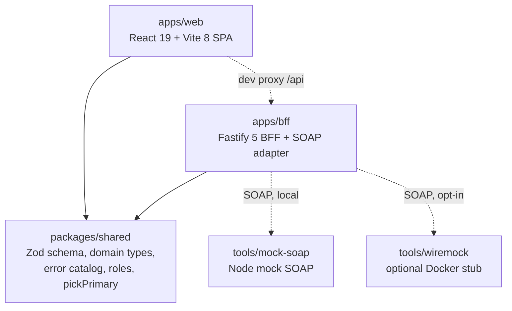
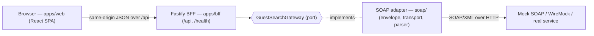
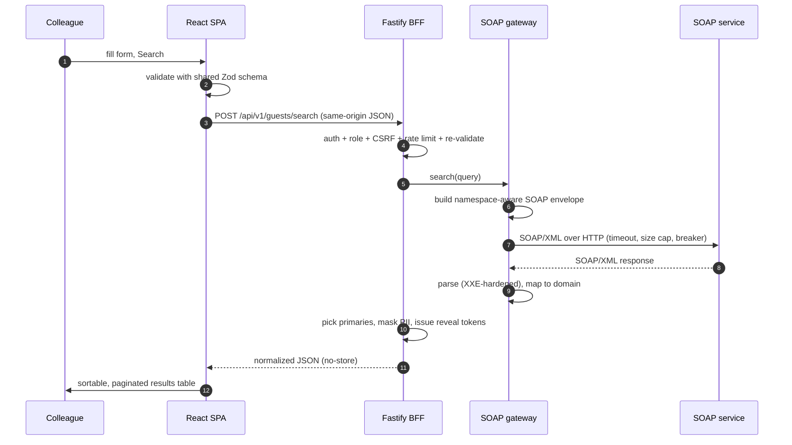
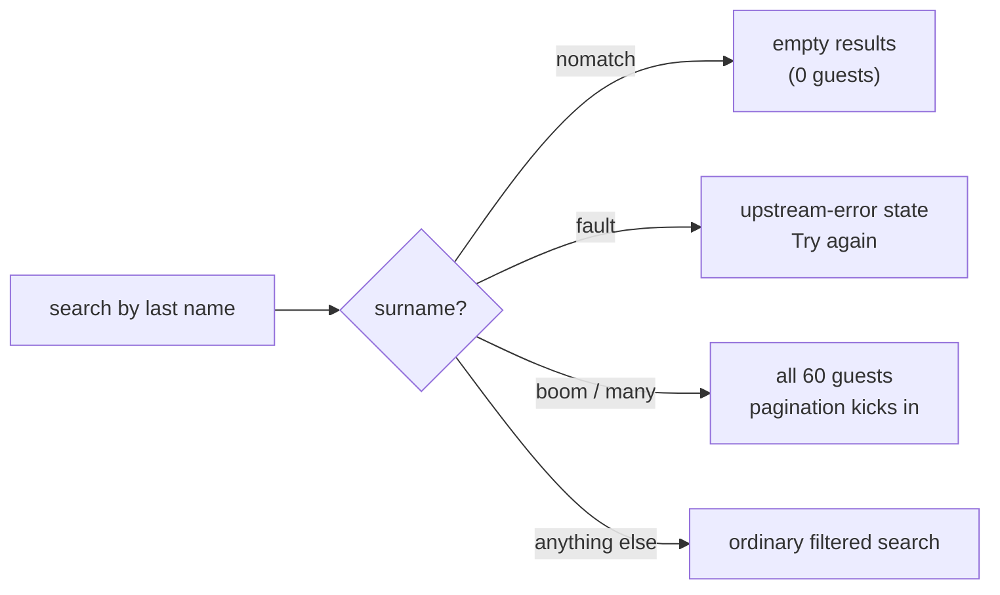

# IHG Guest Search

> Internal colleague tool for searching IHG guest profiles over the legacy SOAP
> `searchGuestRequest` service, through a React SPA and a Fastify BFF. Local-only MVP.

IHG Guest Search lets a support colleague look up guests by name, contact details,
address or loyalty attributes, review the matches in a sortable, paginated table, open a
details drawer, and reveal masked PII when their role allows it. The browser never talks
to SOAP directly: a React single-page app calls a same-origin Fastify backend-for-frontend
(BFF), which validates the criteria, builds the SOAP envelope, calls the upstream service
through a gateway port, masks PII, and returns normalized JSON.

This repository is a **provisional-contract MVP** built for local development. The SOAP
request shape is derived from a single sample the team provided (`docs/Request.txt`); the
response shape and several other items are still blocked pending the WSDL/XSD. See
[Project status and blockers](#project-status-and-blockers). It is **not production-ready** —
see [Not production-ready](#not-production-ready).

## Architecture at a glance

Three npm workspaces plus local tooling:

- **`apps/web`** — React 19 + Vite 8 SPA (Tailwind v4 with IHG brand tokens, TanStack
  Query/Table, React Aria). Talks only to the BFF, same-origin.
- **`apps/bff`** — Fastify 5 BFF: auth/sessions, criteria validation, PII masking with a
  session-bound reveal store, a SOAP gateway (circuit breaker + undici transport), config,
  logging/audit and OpenTelemetry. In production it also serves the built SPA.
- **`packages/shared`** — Zod criteria schema, domain types, error catalog, roles and
  `pickPrimary`, shared by both apps.
- **`tools/mock-soap`** — zero-Docker Node mock SOAP server (≈60 synthetic guests, "magic"
  surnames) used as the default local backend.
- **`tools/wiremock`** — optional Docker stub that serves committed fixture bytes over HTTP.

### Workspace layout



Both apps depend on `packages/shared`; nothing depends on an app. The web app never imports from the BFF, and the BFF's SOAP code never imports Fastify — the arrows above are the only allowed directions.

Request flow:



The SOAP integration sits behind a **ports-and-adapters boundary**: the service depends on
the `GuestSearchGateway` port, and `SoapGuestSearchGateway` is the only adapter that knows
about envelopes, namespaces and XML. When the WSDL/XSD arrives, correcting the contract is
a contained, single-layer change.

### Request lifecycle

What happens on one search, from keystroke to rendered rows:



## Prerequisites

- **Node.js >= 22.15** and npm (the repo pins `engines.node >= 22.15`; the undici 7.x
  transport relies on a recent Node).
- **No Docker required** for the default local run. Docker is only needed for the optional
  WireMock stub.

## Quick start

```bash
npm install
npm run dev:all
```

`dev:all` builds `packages/shared` and `apps/bff` once, then starts three processes with
prefixed output:

| Prefix | Process               | URL                                     |
| ------ | --------------------- | --------------------------------------- |
| `mock` | Node mock SOAP server | `http://127.0.0.1:8080/InitiateService` |
| `bff`  | Fastify BFF           | `http://localhost:3000`                 |
| `web`  | Vite dev server       | `http://localhost:5173`                 |

Open **http://localhost:5173** and search. Ctrl-C stops all three.

The BFF runs with `AUTH_MODE=dev` and the dev persona **`jane.doe`** (Customer Care, has the
reveal role), against the mock with `SOAP_MAX_RESULTS=60`.

**Magic surnames** — search these last names against the mock to exercise each UI state
(case-insensitive):



| Last name        | UI state                                             |
| ---------------- | ---------------------------------------------------- |
| `nomatch`        | empty results (successful, zero guests)              |
| `fault`          | upstream-error state with "Try again" (a SOAP Fault) |
| `boom` or `many` | all 60 guests — drives pagination                    |
| anything else    | an ordinary filtered search over the synthetic seed  |

See [docs/local-development.md](docs/local-development.md) for more detail, including the dev
personas (`jane.doe`, `read.only`, `no.access`).

## Running the pieces individually

```bash
npm run mock:soap                                       # just the mock SOAP server
npm run build:backend && node apps/bff/dist/index.js    # just the BFF (needs env)
npm run dev --workspace=@ihg-guest-search/web           # just the Vite dev server
```

### npm scripts

| Script                  | What it does                                                      |
| ----------------------- | ----------------------------------------------------------------- |
| `npm run dev:all`       | Mock SOAP + BFF + web dev server, all at once (default local run) |
| `npm run dev`           | Run each workspace's own `dev` script                             |
| `npm run build`         | Build every workspace                                             |
| `npm run build:backend` | Build `packages/shared` then `apps/bff`                           |
| `npm run typecheck`     | Type-check the workspaces, tools and e2e projects                 |
| `npm run lint`          | ESLint (zero warnings allowed)                                    |
| `npm run format`        | Prettier write                                                    |
| `npm run format:check`  | Prettier check                                                    |
| `npm test`              | Run the Vitest suite once                                         |
| `npm run test:coverage` | Run Vitest with coverage                                          |
| `npm run test:e2e`      | Run the Playwright E2E + accessibility suite                      |
| `npm run e2e:stack`     | Start the stack used by the E2E tests                             |
| `npm run mock:soap`     | Start only the Node mock SOAP server                              |
| `npm run gen:fixtures`  | Regenerate the generated SOAP response fixtures                   |
| `npm run check:deps`    | Fail the build on unsafe XML dependency versions                  |
| `npm run stub:up`       | Start the optional WireMock Docker stub                           |
| `npm run stub:down`     | Stop the WireMock stub                                            |

## Testing

| Layer                         | Tooling                     | Command                 |
| ----------------------------- | --------------------------- | ----------------------- |
| Unit / integration / property | Vitest (+ fast-check, MSW)  | `npm test`              |
| Coverage                      | Vitest v8 coverage          | `npm run test:coverage` |
| Contract (default)            | Node mock SOAP server       | covered by `npm test`   |
| Contract (optional, Docker)   | WireMock via testcontainers | `npm test` with Docker  |
| End-to-end + accessibility    | Playwright + axe            | `npm run test:e2e`      |

The E2E suite runs an **axe** accessibility scan over each UI state and fails on any
violation. This is a **regression gate, not a WCAG conformance claim** — full WCAG
conformance still requires a manual audit with assistive technologies (see
[docs/a11y-manual-checklist.md](docs/a11y-manual-checklist.md) when present).

The XSD validation tests are **skipped** until the schemas arrive (Blocker B1); they report
an explicit "schemas not supplied" skip message.

## Configuration

All BFF configuration is read from environment variables that map 1:1 to `AppConfig` in
`apps/bff/src/config.ts`. Copy the template and edit it locally:

```bash
cp .env.example .env     # or use the git-ignored .env.local for dev:all overrides
```

[`.env.example`](.env.example) documents **every** key with its default. **Never commit a
real `.env`** (the `.env.*` glob is git-ignored). Key variables:

| Variable                       | Purpose                                                           |
| ------------------------------ | ----------------------------------------------------------------- |
| `AUTH_MODE`                    | `dev` (DevAuthProvider; refuses to start in production) or `oidc` |
| `DEV_AUTH_PERSONA`             | Dev persona in `dev` mode (`jane.doe`, `read.only`, `no.access`)  |
| `SESSION_SECRET`               | Session signing secret (≥ 32 random chars); **required**          |
| `SOAP_ENDPOINT`                | Upstream SOAP service URL; **required**                           |
| `SOAP_MAX_RESULTS`             | Max results requested from SOAP (default 50)                      |
| `SOAP_FEATURE_*`               | Address field feature flags (default off until confirmed by XSD)  |
| `SOAP_HEADER_*`                | SOAP header values from the sample request                        |
| `SOAP_SERVICE_CREDENTIAL`      | Service credential; attached only once the contract defines where |
| `RATE_LIMIT_*_PER_MINUTE`      | Per-session rate limits for search and reveal                     |
| `REVEAL_TTL_MINUTES`           | Lifetime of a PII reveal token                                    |
| `LOG_LEVEL` / `AUDIT_LOG_PATH` | Application and audit logging                                     |
| `TELEMETRY_EXPORTER`           | OpenTelemetry exporter: `none`, `console` or `otlp`               |

Secrets (`SESSION_SECRET`, the service user and credential) are resolved through a
`SecretProvider` abstraction — `EnvSecretProvider` reads them from the environment locally.
Keep real secrets and personal user IDs out of committed files.

## Security and privacy

- **Same-origin SPA** with a required CSRF header (`X-Requested-With: guest-search`) and a
  `Sec-Fetch-Site` cross-site rejection on unsafe methods.
- **Hardened session cookie** (`HttpOnly`, `Secure`, `SameSite=Strict`, `__Host-` prefix
  outside plain-HTTP localhost), with idle and absolute timeouts.
- **PII masked by default.** Phone and email are masked in responses; full values require
  the reveal role and a short-lived, session-bound reveal token.
- **No PII or secrets in logs** — pino redaction plus a separate audit log that records
  criteria field names and event types only.
- **XXE/DTD-hardened SOAP parsing**, plus a dependency check that blocks known-unsafe XML
  library versions (`npm run check:deps`).

## Project status and blockers

This is a provisional-contract MVP. The SOAP request side is modeled from one sample
(`docs/Request.txt`); the response side and several items are **blocked** pending the real
contract. Until the WSDL/XSD arrive, the contract stays `verified: false`, the address
feature flags stay off, the field limits are placeholders, and the XSD tests are skipped.

| ID        | Blocked item                                                                          |
| --------- | ------------------------------------------------------------------------------------- |
| **B1–B3** | WSDL/XSD schemas, sanitized SOAP samples and the confirmed mapping document           |
| **B2**    | The SOAP response shape and header element names (currently provisional)              |
| **B4**    | The Member Type code set (UI uses a synthetic placeholder list)                       |
| **B5/B6** | Placement of the service user/credential and the auth mechanism (WS-Security vs mTLS) |
| **B8**    | The official IHG logo (a text wordmark is used until it arrives)                      |

Open contract question: whether a guest can carry **more than one `name` element** — the
first is used for now, to be confirmed against the XSD.

### Docs

- [docs/local-development.md](docs/local-development.md) — full local setup, personas and the
  optional WireMock stack.
- `docs/mapping.md`, `docs/adr/`, `docs/security/threat-model.md`,
  `docs/a11y-manual-checklist.md` and `docs/open-questions.md` — the mapping document,
  architecture decision records, threat model, manual accessibility checklist and open
  questions. These are authored in task 15.2 and live under [docs/](docs/).

## Not production-ready

This is a local development MVP built against a placeholder SOAP contract. The dev auth
provider is **not a security control**, the contract is unverified, and WCAG conformance has
not been formally audited. Do not point it at a real SOAP endpoint or deploy it as-is.
