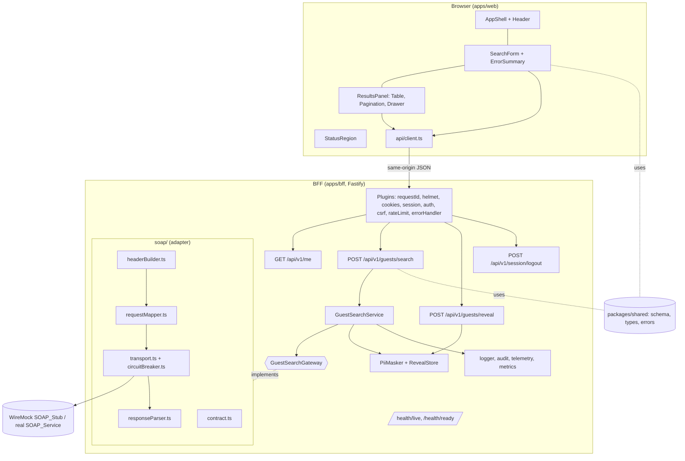
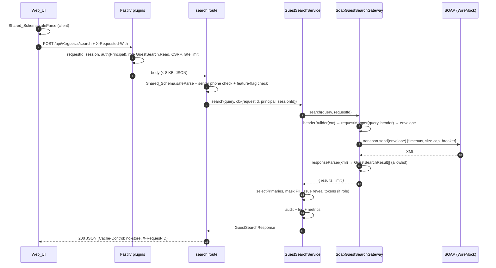
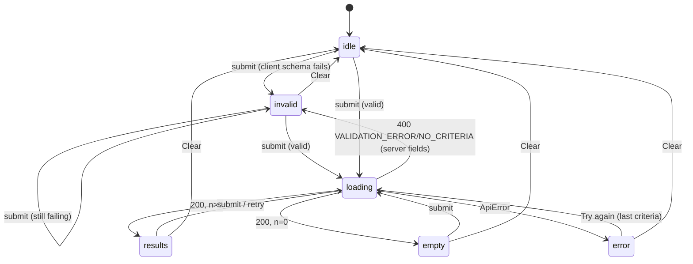
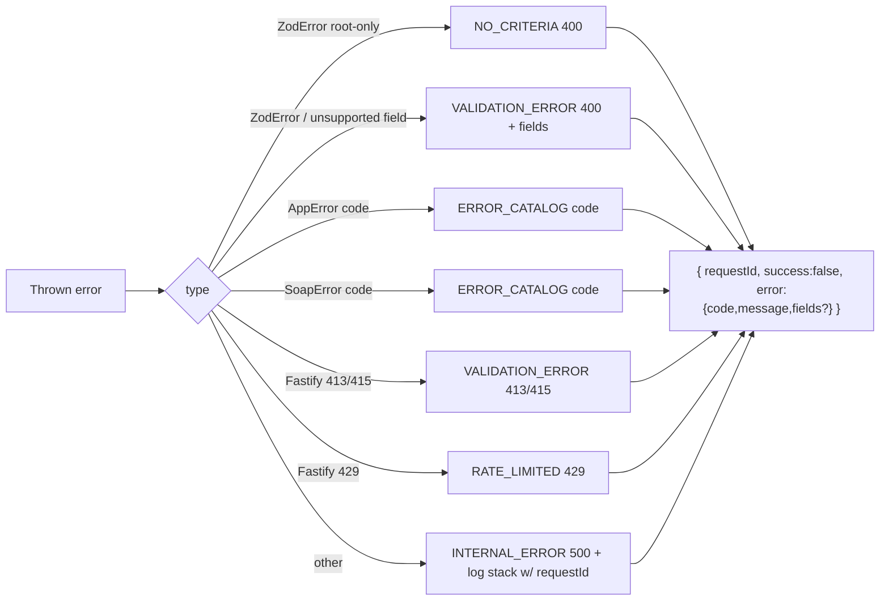

# Design Document — IHG Guest Search

**Inputs:** `requirements.md`, `IHG-Web/copilot-instructions.md` (authoritative), `IHG-Web/IHG-Guest-Search-Blueprint.md`

## Overview

IHG Guest Search is a three-part TypeScript monorepo:

1. **`apps/web`**: a React 19 SPA (Vite 8) that renders the IHG-branded search form, results table, pagination and details drawer. It talks only to the BFF, on the same origin.
2. **`apps/bff`**: a Fastify 5 Node service. It authenticates the colleague (pluggable `AuthProvider`), validates criteria with the shared schema, calls the SOAP Guest Search service through a `GuestSearchGateway` port, masks PII, and returns normalized JSON. In production it also serves the built SPA.
3. **`packages/shared`**: the Zod schema, domain types, error codes and constants shared by both apps.

Locally, a WireMock container stands in for the SOAP service, serving the same synthetic fixtures the tests use. All SOAP knowledge (namespaces, element identities, fixed attributes, status codes) is concentrated in one Contract module. When the real WSDL/XSD arrives, adapting is a contained change: update the contract, enable the address feature flags, and add XSD validation tests.

### Key design decisions

| Decision | Choice | Rationale | Req |
|---|---|---|---|
| Backend runtime | Node 22.15+, Fastify 5 | Typed plugins, built-in body limits and content-type parsing, mature ecosystem (`@fastify/helmet`, `@fastify/rate-limit`, `@fastify/cookie`, `@fastify/static`) | 1.5 |
| SOAP client | Hand-built envelope (xmlbuilder2) + `@xmldom/xmldom` ≥ 0.9.12 + `xpath` | One operation, many namespaces, server-built headers. Runtime WSDL clients push towards raw-string headers. | 9.1, 11.4 |
| HTTP client | Node built-in `fetch` (undici) with `AbortSignal.timeout`, custom `undici.Agent` for connect timeout and mTLS | No extra dependency; streaming body allows size capping | 10 |
| Circuit breaker | Small in-house breaker (closed → open → half-open) | ~60 lines, fully testable, avoids another dependency | 10.7 |
| Sessions | In-memory session store (local), behind a `SessionStore` interface | Local-first; swap for Redis later | 20.10 |
| Auth | `AuthProvider` interface; `DevAuthProvider` now | No IdP locally; OIDC drop-in later | 20 |
| Masking | In the BFF, with server-side reveal tokens | Full values never reach the browser unless revealed | 14 |
| Pagination | Client-side `Paginator` over the returned set | The SOAP contract has no paging; `maxResults` is a cap | 17 |
| UI state | TanStack Query 5 (server state) + React state (form, page, sort) | Cancellation, `gcTime` control, no global store needed | 18, 21.8 |
| Table | TanStack Table 9 (headless) + native `<table>` | Sorting and pagination logic with fully semantic markup | 15 |
| Accessible primitives | React Aria Components (ComboBox, Select, Dialog) | Robust keyboard and screen-reader behaviour | 24 |
| Styling | Tailwind CSS 4 with `@theme inline` brand tokens | Tokens are CSS variables; no hard-coded hex values | 23 |
| Logging | pino with `redact` and a separate audit logger | Structured, fast, path redaction | 22 |
| Telemetry | OpenTelemetry JS SDK (Node), console or OTLP exporter by config | Vendor-neutral; disabled-safe | 22.6, 22.11 |

### Pinned versions (verified 2026-10-21; re-verify at scaffold)

react 19.3.1 · react-dom 19.3.1 · vite 8.3.5 · @vitejs/plugin-react 6.1.2 · @tanstack/react-query 5.104.5 · @tanstack/react-table 9.3.1 · react-aria-components 1.22.1 · react-hook-form 7.90.0 · @hookform/resolvers 6.0.0 · zod 4.6.7 · libphonenumber-js 1.13.15 · i18n-iso-countries 7.14.0 · tailwindcss 4.3.3 · @tailwindcss/vite 4.3.3 · xmlbuilder2 4.0.3 · @xmldom/xmldom 0.9.12 · xpath 0.0.35 · vitest 5.0.5 · @vitest/coverage-v8 5.0.5 · msw 3.0.3 · fast-check 4.10.2 · @fast-check/vitest 0.5.0 · xmllint-wasm 5.3.0 · in-house canonicalizer (xml-crypto dropped: depends on @xmldom/xmldom 0.8.x) · @playwright/test 1.64.1 · @axe-core/playwright 4.14.0 · testcontainers 12.2.1 · WireMock image `wiremock/wiremock:3.13.2`.

Fastify, its plugins, pino, the OpenTelemetry packages, TypeScript (5.x/6.x; adopt 7.x only if all tooling supports it), ESLint and Prettier are pinned to the latest stable versions at scaffold time (task 1.1).

## Architecture

### Component diagram



### Search sequence



### Layer rules (dependency direction)

```text
routes  →  services  →  ports (interfaces)  ←  adapters (soap/)
   ↘          ↘                                   ↘
    shared (schema, types, errors)                contract.ts
```

- `routes/` never imports from `soap/` (Req 6.8).
- `soap/` has no Fastify imports. `requestMapper` and `responseParser` are pure (Req 9.14, 11.10).
- `apps/web` imports only from `packages/shared` and its own modules.

## Components and Interfaces

### packages/shared

```ts
// criteria.schema.ts
export const CRITERIA_FIELDS = [
  'firstName','lastName','email','phone','loyaltyMemberId','memberType',
  'country','stateOrRegion','addressLine1','addressLine2','city','postalCode',
] as const;                                              // UI order (Req 3.2)
export type CriteriaField = typeof CRITERIA_FIELDS[number];

export interface SchemaConfig {
  limits: Record<CriteriaField, number>;                 // Req 4.12 (placeholder until XSD)
  memberIdPattern: RegExp;                               // default /^\d{9}$/ (Req 4.8)
  memberTypes: readonly { code: string; label: string }[]; // Req 3.4, 4.9
}
export function createCriteriaSchema(cfg: SchemaConfig): z.ZodType<GuestSearchQuery, GuestSearchInput>;
export const defaultSchemaConfig: SchemaConfig;

// normalize.ts — pure helpers used by the schema (Req 4.2, 4.3)
export function normalizeText(v: unknown): string | undefined; // trim → NFC → collapse ws → '' ⇒ undefined
export function hasControlChars(s: string): boolean;          // /[\p{Cc}\p{Cf}]/u

// domain.ts — normalized models (copilot-instructions §8 + masking/primary additions)
export interface GuestPhone { number: string; type?: string; location?: string; profileDefault?: boolean }
export interface GuestEmail { address: string; profileDefault?: boolean }
export interface GuestAddress { line1?: string; line2?: string; city?: string; stateOrRegion?: string;
  postalCode?: string; country?: string; locationCode?: string; profileDefault?: boolean }
export interface GuestMembership { memberId?: string; memberType?: string; status?: string }
export interface GuestSearchResult {
  enterpriseId: string; score?: number; status?: string; gender?: string;
  firstName?: string; lastName?: string;
  addresses: GuestAddress[]; phones: GuestPhone[]; emails: GuestEmail[]; memberships: GuestMembership[];
}
export interface GuestSummary {               // API shape = result + primaries + reveal token
  guest: GuestSearchResult;                   // phones/emails masked
  primary: { address?: GuestAddress; phone?: GuestPhone; email?: GuestEmail; membership?: GuestMembership };
  revealToken?: string;
}
export interface GuestSearchResponse {
  requestId: string; success: true; totalResults: number; limit: number; results: GuestSummary[];
}
export interface RevealResponse { requestId: string; phones: GuestPhone[]; emails: GuestEmail[] }
export interface ErrorResponse {
  requestId: string; success: false;
  error: { code: ErrorCode; message: string; fields?: { field: CriteriaField | 'root'; message: string }[] };
}
export interface MeResponse { displayName: string; roles: string[]; authMode: 'dev' | 'oidc' }

// errors.ts (Req 19.1)
export const ERROR_CATALOG: Record<ErrorCode, { http: number; message: string }>;
export type ErrorCode = 'NO_CRITERIA' | 'VALIDATION_ERROR' | 'UNAUTHENTICATED' | 'FORBIDDEN' | 'REVEAL_EXPIRED'
  | 'RATE_LIMITED' | 'UPSTREAM_TIMEOUT' | 'UPSTREAM_UNAVAILABLE' | 'UPSTREAM_HTTP_ERROR' | 'UPSTREAM_FAULT'
  | 'UPSTREAM_TXN_FAILED' | 'UPSTREAM_CONTRACT' | 'UPSTREAM_MALFORMED' | 'INTERNAL_ERROR';

// primary.ts (Req 13) — shared so UI drawer labels match BFF selection.
// T extends object (not { profileDefault?: boolean }) so types without profileDefault,
// e.g. GuestMembership, pass TypeScript's weak-type check; profileDefault is read via `in`.
export function pickPrimary<T extends object>(items: readonly T[]): T | undefined;

// roles.ts
export const ROLES = { READ: 'GuestSearch.Read', REVEAL: 'GuestSearch.RevealPII' } as const;
```

**Schema construction notes.**
- Every field is `z.preprocess(normalizeText, …optional())`.
- The object is `z.strictObject` (Req 4.13), with a root `.refine` for "at least one" that has `path: []` (Req 4.4). The BFF maps this to `NO_CRITERIA`, and all other issues to `VALIDATION_ERROR`.
- Email uses `z.email({ pattern: z.regexes.html5Email })` plus `.max(254)`. If that export name differs in Zod 4.6.7, the WHATWG regex is inlined.
- Phone is format-only in the shared schema (length, no control characters). The BFF adds `libphonenumber-js/max` validation (Req 4.10), so the client bundle stays small.

### apps/bff — configuration

```ts
// config.ts — parsed once at startup with Zod; failure lists missing KEYS only (Req 8.5)
export interface AppConfig {
  nodeEnv: 'development' | 'test' | 'production';
  port: number; trustProxy: boolean;
  auth: { mode: 'dev' | 'oidc'; dev?: { userId: string; displayName: string; roles: string[] } };
  session: { cookieName: string; ttlMinutes: number; secret: string };   // secret via SecretProvider
  soap: {
    endpoint: URL; soapAction: string;
    connectTimeoutMs: number; responseTimeoutMs: number; maxResponseBytes: number;
    maxResults: number; tls?: { caFile?: string; certFile?: string; keyFile?: string };
    features: { addressLine1: boolean; city: boolean; postalCode: boolean };  // Req 9.4 (default false)
    header: { languageCode: string; countryCode: string; channel: string; subChannel: string;
              environment: string; serviceUser: string; sequence: number };
    breaker: { failureThreshold: number; openMs: number };
  };
  rateLimit: { searchPerMinute: number; revealPerMinute: number };
  reveal: { ttlMinutes: number };
  ui: { scoreBands: { high: number; medium: number }; memberTypes: { code: string; label: string }[] }; // served via GET /api/v1/config
  telemetry: { exporter: 'none' | 'console' | 'otlp'; otlpEndpoint?: string };
}
export function loadConfig(env: NodeJS.ProcessEnv, secrets: SecretProvider): AppConfig;

export interface SecretProvider { get(key: string): string | undefined }   // Req 8.4
export class EnvSecretProvider implements SecretProvider { /* reads process.env */ }
```

The UI needs the score-band thresholds, member-type code set, address feature flags and `authMode`. These are served by `GET /api/v1/config`, which returns a non-sensitive `UiConfig` (it carries the member types and flags so the UI can disable unsupported fields consistently with Req 3.5 and 9.5).

### apps/bff — HTTP layer (Fastify plugins, registered in order)

| # | Plugin | Responsibility | Req |
|---|---|---|---|
| 1 | `requestId` | Generate a UUID per request (`genReqId`); set `X-Request-ID`; attach to the logger child | 22.1, 22.10 |
| 2 | `@fastify/helmet` | CSP, Referrer-Policy, nosniff, HSTS (production only), frame-ancestors | 21.1 |
| 3 | `noStore` hook | `Cache-Control: no-store` on `/api/*` | 21.2 |
| 4 | `@fastify/cookie` + `session` | Signed session ID cookie; `MemorySessionStore` behind `SessionStore` | 20.10 |
| 5 | `auth` | `request.principal = await authProvider.authenticate(req)`; `/api/*` returns 401 if null | 20.1, 20.6 |
| 6 | `csrf` | On POST/PUT/PATCH/DELETE: require `X-Requested-With: guest-search`; reject `Sec-Fetch-Site: cross-site` | 21.3, 21.4 |
| 7 | `@fastify/rate-limit` | Per-session key; route-level limits for search and reveal | 21.6, 14.11 |
| 8 | content-type / body limit | `bodyLimit: 8192`; JSON-only parser (415 otherwise) | 6.2, 6.3 |
| 9 | `errorHandler` | Maps `AppError`, Fastify errors (413/415/429) and unknown errors to `ErrorResponse` | 19 |
| 10 | `@fastify/static` (production) | Serves `apps/web/dist` with SPA fallback | 21.5 |

Fastify's default 413/415/429 errors are routed through the same `errorHandler`, so every error has the `ErrorResponse` shape with `requestId`. 413 and 415 use `VALIDATION_ERROR` with a generic message.

**Routes**

```ts
GET  /api/v1/me                 → MeResponse                                  (Req 20.8)
GET  /api/v1/config             → UiConfig                                    (Req 3.4, 3.5, 15.6)
POST /api/v1/guests/search      → GuestSearchResponse | ErrorResponse         (Req 6)
     preHandler: requireRole(ROLES.READ); rateLimit(search)
POST /api/v1/guests/reveal      → RevealResponse | ErrorResponse              (Req 14.7–14.11)
     preHandler: requireRole(ROLES.REVEAL); rateLimit(reveal)
POST /api/v1/session/logout     → 204 + Clear-Site-Data                       (Req 20.11)
GET  /health/live               → { status: 'ok' }                            (Req 22.8)
GET  /health/ready              → { status, checks: { config, soap } }        (Req 22.9)
```

`/health/*` is outside `/api` and bypasses auth. The SOAP readiness probe is a TCP connect to the endpoint host and port, cached for 30 s, with a 1 s timeout. No SOAP call is made, so no credentials are used.

### apps/bff — auth

```ts
export interface Principal { id: string; displayName: string; roles: readonly string[] }
export interface AuthProvider {
  readonly mode: 'dev' | 'oidc';
  authenticate(req: FastifyRequest): Promise<Principal | null>;
}
export class DevAuthProvider implements AuthProvider { /* returns cfg.auth.dev principal */ }
export function createAuthProvider(cfg: AppConfig): AuthProvider;
//  - mode 'dev' && nodeEnv 'production' → throw StartupError (Req 20.4)
//  - mode 'oidc' → throw StartupError('OIDC provider not implemented') (Req 20.5)
export function requireRole(role: string): preHandlerHookHandler;  // 403 FORBIDDEN (Req 20.7, 14.8)
```

In dev mode, a session is created on the first request. The cookie name is `gs_session` on plain-HTTP localhost and `__Host-Http-gs_session` otherwise (Req 20.10).

### apps/bff — service layer

```ts
export interface GuestSearchGateway {                              // port (Req 6.8)
  search(query: GuestSearchQuery, ctx: { requestId: string }): Promise<{ results: GuestSearchResult[]; limit: number }>;
}

export class GuestSearchService {
  constructor(deps: { gateway: GuestSearchGateway; masker: PiiMasker; reveals: RevealStore;
                      audit: AuditLogger; metrics: Metrics; logger: Logger });
  search(query: GuestSearchQuery, ctx: SearchContext): Promise<GuestSearchResponse>;
  reveal(token: string, ctx: SearchContext): Promise<RevealResponse>;
}
// SearchContext = { requestId, principal, sessionId }
```

`search()` steps:
1. Call the gateway.
2. For each result, compute primaries with `pickPrimary`.
3. If the principal has REVEAL, store the unmasked phones and emails in `RevealStore` and attach the token.
4. Mask phones and emails (`PiiMasker`).
5. Write the audit and log entries and metrics.
6. Return the response.

`totalResults = results.length`.

**PiiMasker** (Req 14.1–14.4), pure functions:

```ts
export function maskPhone(n: string): string;   // digits = n.replace(/\D/g,''); len>4 ? `•••• ${last4}` : '••••'
export function maskEmail(e: string): string;   // [local, domain] = split at last '@'; local.length>1 ? `${local[0]}•••@${domain}` : `•••@${domain}`
```

The masked display value replaces `number`/`address` in the response. Masking runs after primary selection, so the primary is always selected from real data.

**RevealStore** (Req 14.6, 14.9):

```ts
export interface RevealEntry { sessionId: string; requestId: string; enterpriseIdHash: string;
  phones: GuestPhone[]; emails: GuestEmail[]; expiresAt: number }
export interface RevealStore {
  issue(entry: Omit<RevealEntry, 'expiresAt'>): string;  // token = 'rt_' + base64url(randomBytes(24))
  consume(token: string, sessionId: string): RevealEntry | null;  // null if unknown/expired/other session; not deleted (re-reveal allowed until TTL)
  dropSession(sessionId: string): void;                  // logout (Req 20.11)
}
export class MemoryRevealStore implements RevealStore { /* Map + clock injection + lazy sweep */ }
```

`enterpriseIdHash` = HMAC-SHA256(sessionSecret, enterpriseId), truncated to 16 hex characters. It is used only for audit (Req 14.10).

### apps/bff — SOAP adapter (`src/soap/`)

#### contract.ts (Req 7)

```ts
export const NS = {
  soap:     'http://schemas.xmlsoap.org/soap/envelope/',
  common:   'http://atp.ihg.com/schema/common/ATPCommonServiceTypes/v1',
  initiate: 'http://crm.ihg.com/schema/v1_0/initiate',
  complex:  'http://common.crm.ihg.com/schema/v1_0/complex',
  svc:      'http://atp.ihg.com/schema/crs/initiate/servicetypes/v1',
  basic:    'http://common.crm.ihg.com/schema/v1_0/basictypes',
} as const;

export const PREFIX: Record<keyof typeof NS, string> =
  { soap: 'soap', common: '', initiate: 'ns2', complex: 'ns3', svc: 'ns4', basic: 'ns5' }; // aliases only

/** Element identity. `verified` flips to true once checked against the XSD (Req 7.5). */
export interface El { ns: keyof typeof NS; local: string; verified: boolean; xsd?: string }
const el = (ns: El['ns'], local: string): El => ({ ns, local, verified: false });

export const EL = {
  // request
  searchGuestRequest: el('svc', 'searchGuestRequest'),
  searchCriteria:     el('svc', 'searchCriteria'),
  name: el('complex','name'), given: el('basic','given'), surname: el('basic','surname'),
  phone: el('complex','phone'), email: el('complex','email'), emailAddress: el('basic','address'),
  address: el('complex','address'), source: el('complex','source'),
  line1: el('basic','line1'), locality1: el('basic','locality1'), region1: el('basic','region1'),
  postalCode: el('basic','postalCode'), country: el('basic','country'),
  membership: el('complex','membership'),
  allAttributes: el('svc','allAttributes'), allHistory: el('svc','allHistory'), maxResults: el('svc','maxResults'),
  // response
  searchGuestResponse: el('svc','searchGuestResponse'), initiateGuest: el('initiate','initiateGuest'),
  enterpriseId: el('initiate','enterpriseId'), transactionStatus: el('common','transactionStatus'),
  // header (names provisional until sample/XSD — Blocker B2)
  header: el('common', 'header'),
} as const;

/** Child order within searchCriteria and searchGuestRequest (Req 9.13). */
export const ORDER = {
  searchCriteria: ['name','phone','email','address','membership'] as const,
  searchGuestRequest: ['searchCriteria','allAttributes','allHistory','maxResults'] as const,
};

export const DEFAULTS = { criteriaStatus: 'O', phoneLocation: 'H', phoneProfileDefault: 'true',
  emailProfileDefault: 'true', addressLocationCode: 'H', addressProfileDefault: 'true',
  allAttributes: 'true', allHistory: 'false' } as const;     // maxResults from config (default 50)

export const SUCCESS = { transactionSuccessful: 'true', overallStatusCode: '0000' } as const;

/** Domain allowlist: response attributes/elements the parser may read (Req 12.10). */
export const ALLOW = {
  guestAttrs: ['score','status','gender'],
  phoneAttrs: ['number','type','location','profileDefault'],
  emailAttrs: ['profileDefault'],
  addressAttrs: ['locationCode','profileDefault'],
  membershipAttrs: ['code','value','status'],
  childElements: ['enterpriseId','name','address','phone','email','membership'],
} as const;
```

A unit test scans `src/**` (excluding `contract.ts`) for namespace URIs and the literals `'0000'`, `'O'` and `'H'` in SOAP files to enforce Req 7.6. An ESLint `no-restricted-syntax` rule blocks template literals and `+` concatenation containing `<` in `soap/` (Req 26.5).

#### headerBuilder.ts (Req 8)

```ts
export interface HeaderContext {
  transactionId: string; sequence: number; timestamp: string;     // ISO 8601 UTC
  languageCode: string; countryCode: string; channel: string; subChannel: string;
  environment: string; serviceUser: string;
}
export function createHeaderContext(cfg: AppConfig['soap']['header'],
  deps: { now: () => Date; requestId: string }): HeaderContext;
export function appendHeader(parent: XMLBuilder, h: HeaderContext): void;   // element names from EL / contract
```

`requestId` is the transaction ID (Req 8.1). The clock is injectable (Req 8.7). The service user and any credential come from `SecretProvider`. They are attached to the header element **only if** the contract defines where they go (Blocker B5/B6). Until then, the header carries only the non-secret fields.

#### requestMapper.ts (Req 9)

```ts
export interface MapperOptions { maxResults: number; features: AppConfig['soap']['features'] }
export function buildSearchGuestRequest(q: GuestSearchQuery, h: HeaderContext, o: MapperOptions): string;
```

Algorithm:
1. Create the doc. Add the `soap:Envelope` and `soap:Header` (via `appendHeader`), then `soap:Body`, then `searchGuestRequest`.
2. Add `searchCriteria` with `@status`.
3. Iterate `ORDER.searchCriteria`. Each group has a builder that returns early when its inputs are absent (Req 9.7–9.11):
   - `name`: `given?`, `surname?`.
   - `phone`: `@number`, `@location`, `@profileDefault`.
   - `email`: `@profileDefault` plus the child `address`.
   - `address`: `@locationCode` and `@profileDefault`, then `source` with `line1?` (flag), `locality1?` (flag), `region1?`, `postalCode?` (flag) and `country?`, in source order. Placeholder order is line1, locality1, region1, postalCode, country, to be confirmed against the XSD.
   - `membership`: `@code?`, `@value?`.
4. Add `allAttributes`, `allHistory` and `maxResults`.
5. Return `doc.end({ prettyPrint: false })`.

Address Line 2 is never read (Req 9.6). Escaping is done by xmlbuilder2 `.txt()` and `.att()`. Before building, values are checked for XML 1.0-illegal characters (U+0000–U+0008, U+000B, U+000C, U+000E–U+001F, U+FFFE, U+FFFF, lone surrogates). The shared schema already rejects Cc/Cf, so this is a defensive assertion that throws `INTERNAL_ERROR`.

The flag check lives in the route: if a disabled field is supplied, the route returns `VALIDATION_ERROR` "This field is not yet supported for search." (Req 9.5). The mapper also ignores disabled fields defensively.

#### transport.ts + circuitBreaker.ts (Req 10)

```ts
export interface SoapTransport { send(envelope: string, ctx: { requestId: string }): Promise<SoapHttpResult> }
export interface SoapHttpResult { status: number; body: string; durationMs: number }

export function createSoapTransport(cfg: AppConfig['soap'], deps: { fetch?: typeof fetch; breaker: CircuitBreaker;
  dispatcher?: Dispatcher /* undici Agent: connect timeout + TLS/mTLS */ }): SoapTransport;
```

Behaviour:
- **Request:** `POST endpoint` with `content-type: text/xml; charset=utf-8` and `soapaction: "<cfg.soapAction>"`. The signal is `AbortSignal.timeout(responseTimeoutMs)`.
- **Body size cap:** the body is read via `response.body` stream. Bytes are accumulated, and the read is aborted with `UPSTREAM_MALFORMED` once they pass `maxResponseBytes`. The body is decoded as UTF-8.
- **Error classification:**

  | Condition | Error |
  |---|---|
  | `AbortError` from the timeout signal | `UPSTREAM_TIMEOUT` |
  | undici `UND_ERR_CONNECT_TIMEOUT`, `ECONNREFUSED`, `ENOTFOUND`, `ECONNRESET` before headers | `UPSTREAM_UNAVAILABLE` (retry once) |
  | Non-2xx status | Body returned to the gateway, which runs the parser for a Fault. If no Fault is found: `UPSTREAM_HTTP_ERROR` (Req 10.9) |

- **Retry:** one retry, only for pre-response connection errors (Req 10.5).
- **Breaker:** `CircuitBreaker.exec(fn)`.
  - It counts only `UPSTREAM_TIMEOUT` and `UPSTREAM_UNAVAILABLE` failures.
  - After `failureThreshold` (default 5) consecutive failures it opens for `openMs` (default 30 s). While open it throws `UPSTREAM_UNAVAILABLE` immediately.
  - In half-open state, one trial request is allowed. Success closes the breaker; failure reopens it.
  - The state is exported as a gauge.

#### responseParser.ts (Req 11, 12)

```ts
export class SoapError extends Error { constructor(readonly code: UpstreamCode, readonly detail?: string) }
// UpstreamCode = 'UPSTREAM_MALFORMED'|'UPSTREAM_CONTRACT'|'UPSTREAM_FAULT'|'UPSTREAM_TXN_FAILED'
export function parseSearchGuestResponse(xml: string): GuestSearchResult[];
export function interpretTransactionStatus(el: Element | null): { ok: true } | { ok: false; code: string };
```

Algorithm:
1. If `/<!DOCTYPE|<!ENTITY/i` matches, throw `MALFORMED` (Req 11.1).
2. Parse with `new DOMParser({ onError: (lvl,msg) => { throw new SoapError('UPSTREAM_MALFORMED', lvl) } })`, using `mimeType 'text/xml'` (Req 11.2–11.3).
   - Wrap the parse in try/catch. Any non-`SoapError` throwable is converted to `MALFORMED`, which supports the totality property (Req 11.11).
   - If `doc.doctype` is set, throw `MALFORMED`.
3. Navigate with namespace-aware helpers. `child(parent, EL.x)` and `children(parent, EL.x)` iterate `childNodes`, comparing `namespaceURI === NS[x.ns] && localName === x.local` (Req 11.4).
   - XPath is not needed for direct children, which avoids XPath injection and prefix concerns. `xpath` is kept for tests only.
4. Find the Envelope and then the Body. If either is missing, throw `CONTRACT` (Req 11.5).
5. Check for `Fault` in the SOAP namespace. If present, throw `FAULT` with detail = text of `faultcode` (Req 11.6).
6. Find `searchGuestResponse`. If missing, throw `CONTRACT` (Req 11.7).
7. Locate `transactionStatus`, searching descendants by NS and local name, and pass it to `interpretTransactionStatus`. If the result is not ok, throw `TXN_FAILED` with detail = `overallStatusCode` (Req 11.8, 11.9).
8. Map each `initiateGuest` child to `mapGuest(el)` (Req 12.1):
   - Read only the attributes in `ALLOW` and the child elements in `ALLOW.childElements`. The parser never enumerates unknown children, so `creditCard` is never touched (Req 12.10, 12.11).
   - `score`: `Number(attr)` if finite, else undefined (Req 12.8).
   - `profileDefault`: `'true'` → true, `'false'` → false, else undefined.
   - Text values are `textContent` trimmed. An empty value becomes undefined (Req 12.9).
   - `firstName` and `lastName` come from the first `name` element. Multiple names are not modelled in the copilot domain model, so the first is used. This is recorded as an open question.
   - `enterpriseId` missing → `''` (the type requires a string). The UI handles keys per Req 15.4.

> **Namespace placement caveat:** which `nsN` each response child uses (for example `initiateGuest` in `initiate` vs `svc`) is provisional (`verified:false`). The parser obtains identities only from `EL`, so correcting them is a one-file change.

#### SoapGuestSearchGateway

```ts
export class SoapGuestSearchGateway implements GuestSearchGateway {
  constructor(deps: { cfg: AppConfig['soap']; transport: SoapTransport; now: () => Date; logger: Logger; metrics: Metrics });
  async search(q, { requestId }) {
    const header = createHeaderContext(cfg.header, { now, requestId });
    const envelope = buildSearchGuestRequest(q, header, { maxResults: cfg.maxResults, features: cfg.features });
    const res = await span('guestSearch.soap', () => transport.send(envelope, { requestId }));
    try { return { results: parseSearchGuestResponse(res.body), limit: cfg.maxResults }; }
    catch (e) { if (res.status >= 300 && !(e instanceof SoapError && e.code === 'UPSTREAM_FAULT')) throw new SoapError('UPSTREAM_HTTP_ERROR'); throw e; }
  }
}
```

A non-2xx response carrying a SOAP Fault is reported as `UPSTREAM_FAULT`. Any other non-2xx response becomes `UPSTREAM_HTTP_ERROR`. A 2xx response is parsed normally.

### apps/bff — observability

- **logger.ts:** pino with the base fields `{ service: 'guest-search-bff' }`, `timestamp: pino.stdTimeFunctions.isoTime` and `redact.remove: true`. Redaction paths:

  ```text
  req.headers.cookie, req.headers.authorization, res.headers["set-cookie"],
  *.firstName, *.lastName, *.email, *.emails, *.phone, *.phones, *.address, *.addresses,
  *.addressLine1, *.addressLine2, *.postalCode, *.loyaltyMemberId, *.memberId, *.enterpriseId,
  *.revealToken, *.token, *.creditCard, *.criteria
  ```

  The Fastify request serializer logs only the method, the URL path (no query) and the request ID (Req 22.3, 22.4).
- **audit.ts:** a separate pino instance (`stream: audit destination`, default `logs/audit.jsonl` locally) with the events `guest.search` and `guest.reveal` (Req 22.5, 14.10).
- **telemetry.ts:** the OpenTelemetry NodeSDK is started before Fastify via `--import ./dist/telemetry.js`.
  - Instrumentations: http/undici/fastify, with request and response body capture disabled.
  - The exporter is selected by config (`none` | `console` | `otlp`) (Req 22.6, 22.11).
- **metrics.ts:** OTel meter instruments:

  ```text
  gs.http.server.duration (histogram)
  gs.soap.duration (histogram)
  gs.soap.results (histogram)
  gs.errors (counter{code})
  gs.breaker.state (observable gauge: 0 closed, 1 half-open, 2 open)
  ```

  These cover Req 22.7.
- **Search log line:**

  ```json
  { "event":"guest.search.completed", "requestId", "criteriaFields":["lastName","phone"],
    "resultCount", "soapDurationMs", "soapHttpStatus", "outcome":"success|empty|error", "errorCode"? }
  ```

### apps/web — structure and components

```text
src/
  main.tsx                    QueryClientProvider (gcTime 5 min, retry false), App
  app/AppShell.tsx            <Header/>, <main id="main">, skip link, <StatusRegion/>, title manager
  app/Header.tsx              UtilityBar (env badge, user, role, Sign out) + BrandBar (BrandLogo, title)
  app/BrandLogo.tsx            (Req 23.6)
  app/useMe.ts, useUiConfig.ts
  styles/tokens.css, theme.css, fonts.css (self-hosted Inter woff2 in /public/fonts)
  api/client.ts               apiFetch(path, init): same-origin, X-Requested-With, JSON, AbortSignal, throws ApiError{code,message,requestId,fields}
  api/guests.ts               searchGuests(criteria, signal), revealGuest(token, signal)
  features/search/
    SearchForm.tsx            RHF + createCriteriaSchema(uiConfig) resolver; 12 fields; Search/Clear
    fields/*.tsx              TextField, CountryComboBox (RAC), MemberTypeSelect (RAC)
    ErrorSummary.tsx          heading + links; focus on mount (tabIndex -1)
    useGuestSearch.ts         useMutation-like controller over useQuery keyed by searchId
  features/results/
    ResultsPanel.tsx          state switch: idle | loading | empty | error | results
    ResultsTable.tsx          TanStack Table v9 (sorting + pagination features), native table
    columns.tsx               14 columns; ScoreBand; MaskedValue + RevealButton; CopyButton
    Pagination.tsx            nav, Prev/Next, numbered, page select, range text
    GuestDetailsDrawer.tsx    RAC Modal/Dialog, focus trap, return focus
    usePaginator.ts           clientPaginator(total, pageSize)
    useReveal.ts              per-row revealed map (in memory), cleared on new search/clear/logout
  a11y/StatusRegion.tsx       context + announce(msg) with debounce; always mounted
  a11y/useShortcut.ts         "/" → focus first name when activeElement not text input
  lib/format.ts, sort.ts      score sort (undefined last), locale compare
```

**Search flow state machine (`useGuestSearch`):**



- Each submit creates a new `searchId`.
- `useQuery({ queryKey: ['guest-search', searchId], queryFn: ({signal}) => searchGuests(criteria, signal), gcTime: 5*60_000, staleTime: Infinity, retry: false })`. The criteria live in component state, not the query key, so they never sit in a serializable cache key. The previous query is cancelled via `queryClient.cancelQueries` (Req 18.3).
- Submit is ignored while loading (Req 18.2).
- On success: set page 0 (Req 17.8), clear revealed values (Req 14.13), announce "{n} guests found", and focus the caption (Req 18.4).
- On sign-out: call `POST /api/v1/session/logout`, then `queryClient.clear()`, reset state and redirect to `/` (Req 21.8, 14.13).

**Results table details:**
- **Columns** (Req 15.1, 15.2): accessors read from `GuestSummary.primary.*` and `guest.*`.
- **Address cell:** `primary.address.line1`.
- **Sorting** (Req 15.5, 15.7): TanStack `rowSortingFeature` with a custom score comparator (undefined last, stable). The default sort is `[{ id: 'score', desc: true }]`. Sort buttons sit inside the `<th>`, and `aria-sort` is set only on the active column.
- **Pagination:** TanStack `rowPaginationFeature` with `pageSize: 50`. `usePaginator` provides `{ pageIndex, pageCount, from, to, total }` and is the abstraction point for future server paging (Req 17.2).
- **Row ID** (Req 15.4): the key is the Enterprise ID when present and unique within the result set, otherwise `{enterpriseId or "row"}#{index}`. The duplicate set is precomputed per result set.
- **Score band** (Req 15.6): `score >= high` → High, `>= medium` → Medium, else Low. Rendered as a text chip with an icon. Thresholds come from `UiConfig` (default 90/70).
- **Masked cell** (Req 14.12): shows the masked value. If the principal has REVEAL and the row has a `revealToken`, an icon button "Reveal contact details for {First Last}" is shown. On success the row's phones and emails are swapped in from the reveal map. On `REVEAL_EXPIRED` the message is shown inline.
- **Limited notice** (Req 15.11): shown when `totalResults === limit`.
- **Scroll region** (Req 15.8): `<div role="region" aria-labelledby={captionId} tabIndex={0}>`.

**Focus and announcements (Req 5, 17.9, 18, 24.9):**
- Only `StatusRegion` (`role="status"`) is used for non-errors.
- `ErrorSummary` is not a live region. It receives focus instead (Req 5.2), which avoids double announcement.
- The search error alert uses `role="alert"` and does not move focus. The "Try again" button follows it in tab order.

**Title manager (Req 24.11):** the states are `Search`, `Searching`, `{n} results`, `No results`, `Error` and `Fix errors`.

### Styling (Req 23)

`styles/tokens.css` holds the tokens exactly as listed in Req 23.2 (the CSS from blueprint §5.6). `theme.css` maps them through `@theme inline`. Components use only Tailwind token utilities (`bg-primary`, `text-navy`, `border-border-strong`, …). An ESLint/stylelint check forbids hex literals in `src/**/*.tsx` and component CSS (Req 23.1).

Inter is installed as `@fontsource-variable/inter`, pinned, bundled by Vite and served from the app origin (Req 23.3, 21.9).

## Data Models

### API request/response examples (synthetic)

**Search request**

```json
{ "criteria": { "lastName": "Testperson", "country": "US", "stateOrRegion": "GA" } }
```

**Search success response**

```json
{ "requestId": "6f1c…", "success": true, "totalResults": 2, "limit": 50,
  "results": [
    { "guest": { "enterpriseId": "900000001", "score": 97, "status": "A", "firstName": "Alex", "lastName": "Testperson",
        "addresses": [{ "line1": "1 Example St", "city": "Atlanta", "stateOrRegion": "GA", "postalCode": "30301", "country": "US", "locationCode": "H", "profileDefault": true }],
        "phones": [{ "number": "•••• 0101", "type": "M", "location": "H", "profileDefault": true }],
        "emails": [{ "address": "a•••@example.test", "profileDefault": true }],
        "memberships": [{ "memberId": "900000101", "memberType": "PC", "status": "A" }] },
      "primary": { "address": { "...": "same as addresses[0]" }, "phone": { "number": "•••• 0101" },
                   "email": { "address": "a•••@example.test" }, "membership": { "memberId": "900000101" } },
      "revealToken": "rt_Q2h…" } ] }
```

**Error response**

```json
{ "requestId": "6f1c…", "success": false,
  "error": { "code": "UPSTREAM_TIMEOUT", "message": "The guest search service did not respond in time. Please try again." } }
```

### Server-side state

| Store | Key | Value | TTL | Interface |
|---|---|---|---|---|
| Sessions | session ID (signed cookie) | `{ id, createdAt, lastSeen, principalId }` | idle 30 min / absolute 8 h | `SessionStore` (memory) |
| Reveal tokens | `rt_…` | `RevealEntry` | 10 min | `RevealStore` (memory) |
| Rate limits | session ID | counters | 1 min window | `@fastify/rate-limit` (memory) |
| SOAP readiness | — | `{ ok, checkedAt }` | 30 s | in-module cache |

The memory stores are single-instance only. This is documented as a production limitation (an ADR names Redis as the follow-up).

### Fixtures (synthetic, shared by tests and WireMock)

```text
apps/bff/test/fixtures/soap/
  request-name-phone.xml          request-loyalty.xml
  response-single.xml             response-multiple.xml          response-empty.xml
  response-repeated-contacts.xml  response-no-default.xml        response-multiple-defaults.xml
  response-missing-optional.xml   response-odd-prefixes.xml      response-default-namespace.xml
  response-with-cc-token.xml      response-failure-status.xml    response-60-guests.xml
  fault-client.xml                fault-server.xml
  malformed-truncated.xml         malformed-proxy-502.html       malformed-dtd.xml
```

The fixtures use namespace URIs from `contract.ts` and the provisional element placement. `response-60-guests.xml` is generated by `scripts/gen-fixtures.ts` so the E2E pagination tests have more than 50 rows. It requires `maxResults` ≥ 60 in the E2E config, which exercises Req 17 meaningfully.

WireMock mappings (`wiremock/mappings/*.json`) choose a scenario using `matchesXPath` on `surname`:

| Surname | Scenario |
|---|---|
| `Single` | single guest |
| `Many` | 60 guests |
| `Nobody` | empty result |
| `Fault` | SOAP Fault |
| `Broken` | failure status |
| `Garbage` | malformed response |
| `Slow` | `fixedDelayMilliseconds` > timeout |
| `Proxy` | HTTP 502 with an HTML body |
| (default, lowest priority) | multiple guests |

Matching uses `xPathNamespaces` bound to the contract URIs.

## Correctness Properties

These properties are tested with fast-check (≥ 200 runs each in CI).

| # | Property | Statement | Req |
|---|---|---|---|
| P1 | Request round-trip | For all valid `GuestSearchQuery` q (arbitrary Unicode text without Cc/Cf, valid email/phone/country shapes), parsing `buildSearchGuestRequest(q, h, o)` with the namespace-aware test reader yields, for each supplied mapped field, exactly the normalized value, and for each absent group no element | 9.15, 9.7–9.11 |
| P2 | Blank omission | For all queries where a group's inputs are undefined, the envelope contains no element with that group's (ns, local) | 9.7–9.11 |
| P3 | Parser totality | For all strings s (fully arbitrary, plus mutated fixture XML), `parseSearchGuestResponse(s)` returns an array or throws `SoapError` with a code in `UpstreamCode`, never another error type | 11.11 |
| P4 | Prefix invariance | For all valid fixture responses and all random prefix assignments (including the empty/default namespace and re-declaration mid-tree), the parsed results deep-equal the canonical parse | 11.12 |
| P5 | Token exclusion | For all generated guests with `creditCard/token` values t (random strings ≥ 8 chars), `JSON.stringify(service response)` contains neither t nor `creditCard` nor `token` (excluding the key `revealToken`, matched exactly) | 12.13 |
| P6 | Pagination partition | For all `total ∈ [0, 1000]`, concatenating pages from `clientPaginator(total, 50)` reproduces indices `0..total-1` in order, each exactly once; `pageCount === Math.ceil(total / 50)` | 17.12 |
| P7 | Primary selection | For all arrays of items with random `profileDefault`, `pickPrimary` returns the first true item if any exists, else `items[0]`, else undefined | 13.1–13.3 |
| P8 | Masking | For all phone strings with > 4 digits, `maskPhone` output ends with the last 4 digits and contains no other digit; for all emails, `maskEmail` output contains the full domain and at most 1 character of the local part | 14.1–14.3 |
| P9 | Normalization idempotence | For all strings s, `normalizeText(normalizeText(s)) === normalizeText(s)` | 4.2 |

## Error Handling



Rules:
- The user `message` always comes from `ERROR_CATALOG`; the error's own text is never used (Req 19.3).
- `SoapError.detail` (`faultcode` or `overallStatusCode`) goes to logs only.
- `fields[].message` comes from schema messages only; values are never echoed (Req 4.14).
- Stack traces are logged only for `INTERNAL_ERROR`, and only in the app log, not the audit log.
- **Startup errors:**
  - `StartupError` covers missing config keys (names only), dev auth in production, and OIDC not implemented.
  - These are printed to stderr and the process exits with code 1 (Req 8.5, 20.4, 20.5).
- **UI mapping:**
  - `ApiError.code` drives the alert copy (the server message is used as is).
  - `VALIDATION_ERROR` and `NO_CRITERIA` go to the ErrorSummary.
  - `UNAUTHENTICATED` shows a "Sign in again" banner.
  - `REVEAL_EXPIRED` is shown inline in the row or drawer.

## Testing Strategy

| Layer | Tool | Location | Covers |
|---|---|---|---|
| Static | `tsc --noEmit`, ESLint (incl. no-console in BFF, no string-built XML in `soap/`, no hex in components), Prettier | all | Req 1, 23.1, 26.5 |
| Unit (shared) | Vitest | `packages/shared/test` | Schema rules (Req 4), normalize, pickPrimary, error catalog |
| Unit (BFF) | Vitest | `apps/bff/test/unit` | contract literal scan, headerBuilder, requestMapper, responseParser, transport (mocked fetch), circuit breaker (fake clock), masker, reveal store, config loader, auth factory |
| Property | fast-check + @fast-check/vitest | `apps/bff/test/property`, `packages/shared/test/property`, `apps/web/test/property` | P1–P9 |
| Snapshot | Exc-C14N-style in-house canonicalizer (xml-crypto dropped: depends on @xmldom/xmldom 0.8.x) + `toMatchFileSnapshot` (awaited) | `apps/bff/test/unit/__snapshots__` | Canonical request envelopes for the 2 reference requests |
| XSD | xmllint-wasm | `apps/bff/test/xsd` | `describe.skipIf(!hasSchemas)`; validates all mapper outputs (Req 25.7) |
| Integration (BFF) | Vitest + `fastify.inject` + MSW 3 (`msw/node`, intercepting the SOAP fetch) | `apps/bff/test/integration` | Every endpoint, every error code, headers, CSRF, 413/415, rate limit, reveal lifecycle, logout, log-leak test (pino destination captured in memory) |
| Component (web) | Vitest (jsdom) + Testing Library + MSW REST handlers | `apps/web/test` | Form, ErrorSummary focus, Clear, loading/duplicate submit, empty/error, table columns/sort/keys, pagination states (0/1/49/50/51), drawer focus trap, reveal, shortcut, title |
| Contract stub | testcontainers + WireMock 3.13.2 | `apps/bff/test/contract` | Gateway against real HTTP + fixtures, delay → timeout, 502 HTML |
| E2E + a11y | Playwright + @axe-core/playwright (tags wcag2a/aa, wcag21a/aa, wcag22aa) | `e2e/` | Req 25.9 flows; axe on: initial, invalid, loading, results, empty, error, page 2, drawer open, revealed |

**Coverage** (Vitest v8): global lines 85 / branches 80, and `apps/bff/src/soap/**` per-file lines 95 / branches 90 (Req 25.10).

**Log-leak test** (Req 25.6): it boots the app with an in-memory pino destination for both the app log and the audit log. It searches against `response-with-cc-token.xml`, which contains a unique synthetic PII marker, then reveals. The test asserts that no captured line contains any PII marker, the token value, or `creditCard`.

**Manual verification (not automatable):** screen-reader passes (NVDA + Firefox/Chrome, VoiceOver + Safari), keyboard-only, 400% zoom, and a contrast spot-check with a tool. These are recorded in `docs/a11y-manual-checklist.md`. Full WCAG conformance requires this manual testing and an expert review.

## Security Considerations

The threat model summary (STRIDE) is recorded in `docs/security/threat-model.md`:

| Threat | Mitigation | Req |
|---|---|---|
| XXE / entity expansion from upstream | DOCTYPE/ENTITY reject, xmldom never resolves external entities, size cap | 11.1, 10.6 |
| XML injection into the envelope | xmlbuilder2 escaping; lint rule against string XML; property P1 | 9.1, 9.2 |
| PII bulk scraping by an insider | Role check, per-session rate limits, audit log, masking by default | 14, 21.6, 22.5 |
| Card-token leakage | Allowlist parsing; property P5; log-leak test | 12.11, 25.6 |
| CSRF | SameSite=Strict, custom header, Fetch Metadata, JSON-only | 21.3, 21.4, 6.2 |
| XSS | React escaping, strict CSP without inline script, no third-party scripts | 21.1, 21.9 |
| Info disclosure via errors | Catalog messages only; details are logged with the requestId | 19.3 |
| SSRF | Endpoint from config only | 2.6 |
| Dev auth in production | Startup refusal | 20.4 |
| Vulnerable XML libraries | CI version gate for xmldom; libxmljs2 banned; audit | 26.2, 26.4 |
| Secrets in git | `.env.example` only; gitleaks in CI | 1.8, 26.3 |

**Limitations to state honestly:**
- The memory stores are single-instance.
- The dev auth provider is not a security control.
- The XSD validation tests are skipped until the schemas arrive.
- WCAG conformance needs a manual audit.

## Open Items Carried From Blueprint

- **B1–B3:** WSDL/XSD, samples and the mapping doc. Until they arrive, the contract stays `verified:false`, the address feature flags stay off, the field limits are placeholders, and the XSD tests are skipped.
- **B4:** the Member Type code set. Until then, `UiConfig.memberTypes` uses a synthetic placeholder list labelled "(placeholder)".
- **B5/B6:** header placement of the service user and credentials, and the auth mechanism (WS-Security vs mTLS).
- **B8:** the official IHG logo. The text wordmark is used until it arrives.
- **Multiple `name` elements per guest:** the first is used for now. Confirm against the XSD whether more than one name can appear.
